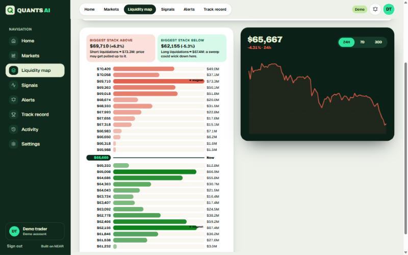
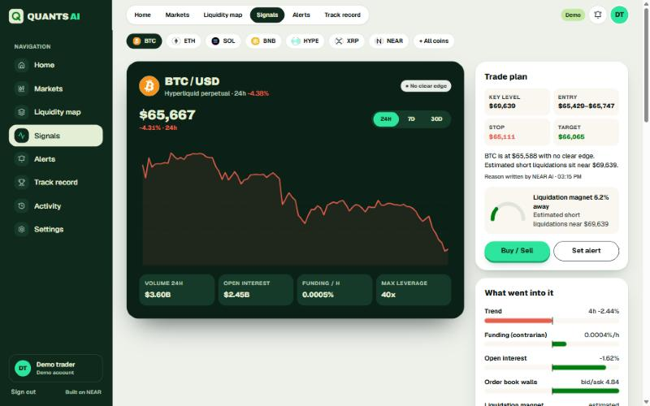
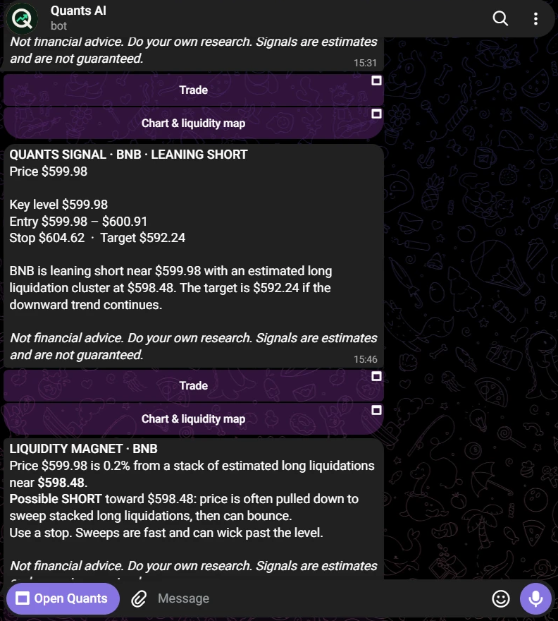
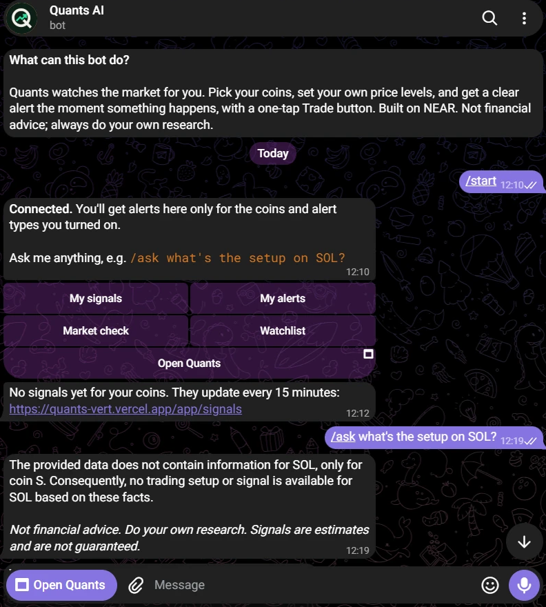
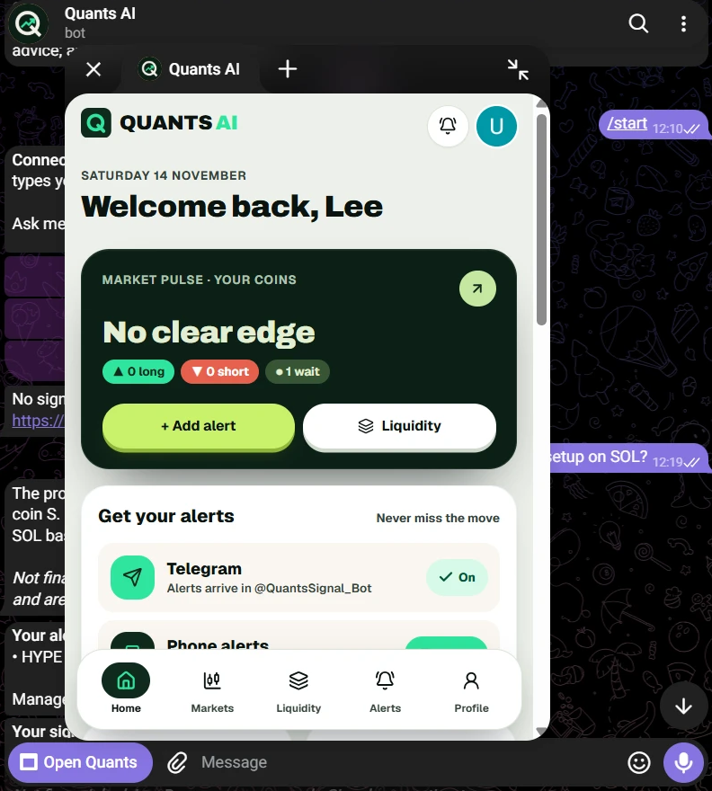
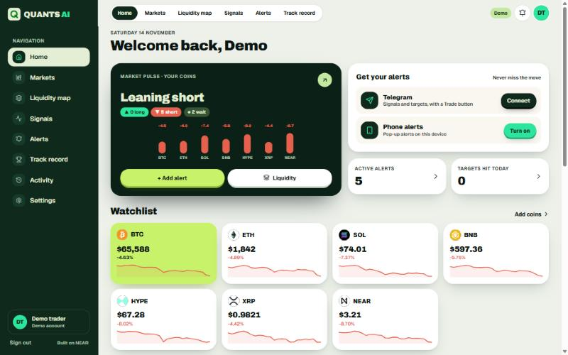
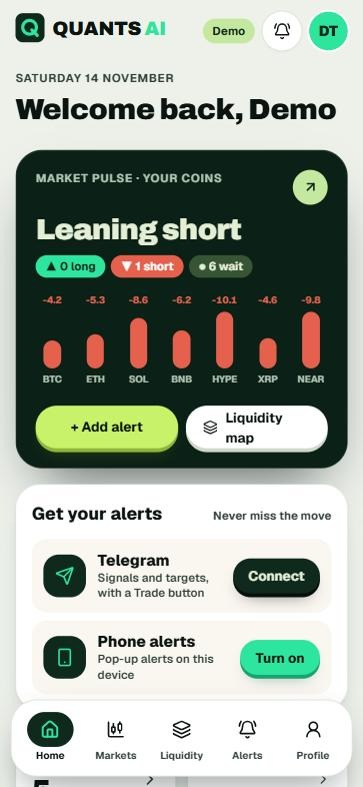
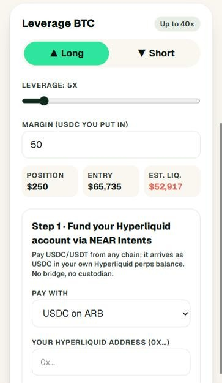

# Quants AI: never miss the move

**An AI market agent that reads crypto market structure, tells you when to act (or wait), and lets you trade from the alert without ever handing over your funds. Built on NEAR.**

| | |
|---|---|
| **Live app** | https://quants-vert.vercel.app (click **Try demo**: no sign-up) |
| **Telegram bot** | [@QuantsSignal_Bot](https://t.me/QuantsSignal_Bot) |
| **Built for** | NEAR HACKATHON, November 2026 |
| **Tracks** | `defi` · `agents` · `privacy` |
| **NEAR integrations** | NEAR Intents (1Click API) · NEAR AI Cloud · NEAR wallet sign-in (NEP-413) |

> Not financial advice. Do your own research. Signals are estimates and are not guaranteed.

---

## Core features at a glance

### 1. Liquidity Map: see where the market is likely to go
Pick any of 179 coins and a window (24H, 48H, 3D or 1W). Quants AI shows where liquidations are stacked **above** price (a magnet that can pull price up: a possible **long** target) and **below** price (a sweep zone: a possible **short** target). It's a free, built-in alternative to paid liquidation heatmaps.

<p align="center"></p>

### 2. Clear signals with a reason, written by NEAR AI
Every 15 minutes the agent reads market structure for the coins people follow and gives one clear call: **Leaning long**, **Leaning short** or **Wait**, with entry, stop and target, a liquidity-magnet gauge, and a two-line reason written privately by **NEAR AI Cloud**. Every call is scored after 4h and 24h on a public track record.

<p align="center"></p>

### 3. Alerts that reach you on Telegram, with a Trade button
Only for the coins and alert types you choose. Signals, **WAIT** messages, liquidity magnets ("possible SHORT toward $598.48") and your own price targets arrive in [@QuantsSignal_Bot](https://t.me/QuantsSignal_Bot), each with **Trade** and **Chart & liquidity map** buttons. The bot has a menu (My signals, My alerts, Market check, Watchlist) and opens the full app inside Telegram.

<p align="center">
  
  
  
</p>

### 4. One-tap trades through NEAR Intents, without custody
**Leverage (long/short):** fund your own Hyperliquid account through **NEAR Intents** from USDC/USDT on any chain, then open the position with the signal's levels. **Spot (buy/sell):** swap through **NEAR Intents** straight into your own wallet. Quants AI never holds funds.

### 5. A dashboard built for phones and desktops
Market pulse for your coins, a "Get your alerts" card (Telegram + phone push), your watchlist with live mini-charts, and the latest signals. Installable as an app with phone notifications.

<p align="center">
  
  
  
</p>

---

## Contents
0. [Core features at a glance](#core-features-at-a-glance)
1. [The problem](#1-the-problem)
2. [What Quants does](#2-what-quants-does)
3. [How NEAR is used (in detail)](#3-how-near-is-used-in-detail)
4. [How it works: the agent loop](#4-how-it-works-the-agent-loop)
5. [How signals are made](#5-how-signals-are-made)
6. [Personal alerts and reminders](#6-personal-alerts-and-reminders)
7. [Telegram bot](#7-telegram-bot)
8. [Trading without custody](#8-trading-without-custody)
9. [Try it: step by step for judges](#9-try-it-step-by-step-for-judges)
10. [Architecture](#10-architecture)
11. [Security and privacy](#11-security-and-privacy)
12. [Cost and scale](#12-cost-and-scale)
13. [Run it yourself](#13-run-it-yourself)
14. [Project status, limits and what's next](#14-project-status-limits-and-whats-next)

---

## 1. The problem

Most retail crypto traders lose not because they have no idea, but because of **timing and noise**:

- **You can't watch charts 24/7.** Moves happen while you sleep or work. By the time you look, the entry is gone.
- **Real market structure is hidden or paywalled.** Experienced traders watch *where liquidity is stacked*: price levels where many leveraged positions would be liquidated. Price is often pulled toward those levels ("liquidity magnets"). Good liquidation heatmaps are paid products.
- **Alert bots are noisy and generic.** They blast everyone the same message, with no levels, no reasoning and no honesty about how often they're right.
- **Acting on an alert is slow and risky.** You jump between a chart, an exchange and a wallet, and often have to deposit funds with a custodian first.

## 2. What Quants does

Quants is an **agent that works for each user individually**:

1. **Watches the market for you.** 179 coins (every coin listed on Hyperliquid), refreshed every minute.
2. **Shows a live Liquidity Map** for any of the 179 coins over 24H, 48H, 3D or 1W: where estimated liquidations are stacked above and below price.
3. **Reads market structure every 15 minutes**: funding rate, open-interest change, order-book walls, trend, and **estimated liquidation clusters** (a free, open version of a liquidation heatmap). It outputs one of three clear calls per coin: **Leaning long**, **Leaning short**, or **No clear edge (wait)**, with a key level, entry zone, stop and target, plus a two-line plain-English reason written by **NEAR AI**.
4. **Only messages you about what you chose.** You pick your coins and which alert types you want per coin. Someone who only follows HYPE never gets a BTC message.
5. **Remembers your own price levels.** "Tell me if SOL drops 5%", "HYPE at $25.07", "remind me tomorrow at 9am if BTC is below 95k". Any coin, any price, above or below. These are separate from signals: a reminder only tells you **your target was hit**.
6. **Reaches you where you are**: Telegram, phone notifications (installable web app) and the dashboard.
7. **Lets you act in one tap.** Every alert has a **Trade** button that opens a phone-first trade page with two tabs: **Leverage (long/short)**, where you fund your own Hyperliquid account **through NEAR Intents** from any chain and open the position with the signal's levels, and **Spot (buy/sell)**, which swaps **through NEAR Intents straight into your own wallet**. Quants never holds funds and is not an exchange.
8. **Keeps itself honest.** Every signal is scored after 4h and 24h (hit target / hit stop / neither) and the real hit rate is shown publicly, even when it's low.

### Who it helps
- **Part-time traders** who can't watch charts but want to catch moves at levels they care about.
- **Swing traders** who already think in terms of liquidity and want that view without a paid tool.
- **Newer traders**, who get explained, labelled setups ("why") and an honest track record instead of hype.

### The message types (never mixed)

| Type | Triggered by | Example |
|---|---|---|
| **Quants signal** | The agent: a new setup, or the edge disappearing (**WAIT**) | `QUANTS SIGNAL · SOL · LEANING LONG` with entry, stop, target and the NEAR AI reason |
| **Liquidity magnet** | The agent: price within 1% of a big estimated liquidation stack | `LIQUIDITY MAGNET · BTC`: price is 0.8% from estimated short liquidations near $71,060. **Possible LONG**: price is often pulled up to sweep them. (Stack below → **possible SHORT**.) |
| **Target hit / Reminder** | The user's own level or time | `TARGET HIT · HYPE`: your alert "HYPE below $25.07" was hit, price now $25.01 |
| **Market check** (every 4h, optional) | The agent's "wait or act" summary of your coins | `MARKET CHECK`: no clear setups on your coins, best move right now is wait |

## 3. How NEAR is used (in detail)

NEAR is not a logo here: each of the three integrations does a job the product could not do the same way without it.

### 3.1 NEAR Intents: non-custodial, cross-chain trading from any alert

**What it does in Quants:** the Trade button on every alert opens a trade page where the user buys or sells the coin **spot**, paying with USDC/USDT on the chain they already use (Base, Arbitrum, Solana, Ethereum, BNB Chain, NEAR, …), and receives the coin **in their own wallet on its native chain**. Quants never touches the money.

**How it's integrated** ([`src/lib/trade/oneclick.ts`](src/lib/trade/oneclick.ts), [`src/app/api/trade`](src/app/api/trade), [`src/components/TradeFlow.tsx`](src/components/TradeFlow.tsx)) via the official **1Click API** (`https://1click.chaindefuser.com`):

1. `GET /v0/tokens`: the live list of tokens and chains NEAR Intents supports. Quants maps Hyperliquid tickers to it (including 1000× tickers like `kPEPE → PEPE`). **46 of the 179 coins** are spot-tradable this way; the Markets page labels each coin "Spot · NEAR Intents" or "Perp".
2. `POST /v0/quote` with `dry: true`: a **price check** with no deposit address. Shows "you send X, you get ≈Y, about N minutes".
3. `POST /v0/quote` with `dry: false`: a real quote with a **quote-specific deposit address**. The user sends from their own wallet; solvers fill the intent; the coin is delivered to the **recipient address the user typed** (`recipientType: DESTINATION_CHAIN`). If anything fails, funds are refunded to the user's **refund address** (`refundType: ORIGIN_CHAIN`).
4. `GET /v0/status?depositAddress=…`: the trade page polls status (`PENDING_DEPOSIT → PROCESSING → SUCCESS / REFUNDED`).

Safety around it: receiving and refund addresses are **validated per chain** before any quote (EVM, Bitcoin bech32/legacy, Solana, NEAR named/implicit, Tron, XRP, Sui, Aptos, Stellar, Cardano, Litecoin, Dogecoin); slippage is bounded (0.1–3%); amounts are converted to smallest units with BigInt (no float rounding); the app fee hook (`appFees`, paid to a NEAR account inside Intents) is wired but set to **0**.

5. **Leverage funding:** for long/short trades, Quants quotes `destinationAsset: 1cs_v1:hypercore:hip1:…` (Hyperliquid USDC) with the user's Hyperliquid `0x` address as `recipient`. NEAR Intents credits the USDC **directly to the user's Hyperliquid perps balance** from USDC/USDT on any supported chain, with no bridge and no custodian ([`src/app/api/trade/fund`](src/app/api/trade/fund/route.ts), [`src/components/LeverageFlow.tsx`](src/components/LeverageFlow.tsx)). The Leverage tab then shows position size, an estimated liquidation price, and the signal's entry/stop/target to open on Hyperliquid. So **every** trade route, spot or leverage, moves money through NEAR Intents.

**Why NEAR Intents:** it gives a one-step, cross-chain, non-custodial swap from a single API. Without it, "trade from the alert" would mean either holding user funds (custody) or sending users through several bridges and DEXes.

### 3.2 NEAR AI Cloud: private AI for analysis and language

**What it does in Quants:**
- Writes the **two-line reason** for each signal ("BTC is flat with no clear edge; estimated long liquidations sit near $67,676.").
- Understands **plain-English alerts** that the rule parser can't ("remind me tomorrow at 9am if BTC is below 95k" → a structured rule with a time in the user's time zone).
- Answers **`/ask` questions on Telegram** ("what's the setup on SOL?") using only the stored market data and the user's own alerts.

**How it's integrated** ([`src/lib/ai`](src/lib/ai)): NEAR AI Cloud's OpenAI-compatible endpoint `https://cloud-api.near.ai/v1/chat/completions` with an open-weights model (`Qwen/Qwen3.6-35B-A3B-FP8`, "thinking" switched off for short, cheap replies). It is the **only** AI provider used.

Guard-rails: user text is sanitised and framed as untrusted data (prompt-injection resistant); AI output is validated against a strict schema (the coin must exist, numbers must be in range) before the user confirms it; AI can never run code or touch other users' data. If NEAR AI is unavailable, signals still work and the reason falls back to a template sentence, so **the app never breaks because of AI**.

**Why NEAR AI:** users' trading intentions ("tell me if SOL drops 5%") and questions are sensitive. NEAR AI Cloud provides private inference for open models, which fits the privacy track and keeps the agent's "brain" on NEAR.

### 3.3 NEAR wallet sign-in (optional)

Users can sign in by **signing a message** with any NEAR wallet (HOT, Meteor, MyNearWallet, Intear, …) through `@hot-labs/near-connect`. No transaction, no gas. ([`src/lib/near/verify.ts`](src/lib/near/verify.ts))

The server verifies a **NEP-413** signed message: it rebuilds the NEP-413 payload (tag `2^31+413`, message, 32-byte nonce, recipient), checks the **ed25519 signature**, checks a **stateless 5-minute HMAC nonce** (no replay), and confirms through NEAR RPC (`view_access_key`) that the public key is a **full-access key of that account**. The NEAR account becomes the user's identity in Quants. Google and Telegram sign-in also exist, so a wallet is never required just to try the product.

## 4. How it works: the agent loop

```
 every 1 min ─▶ read market (1 call for everyone) ─▶ check every user's own levels (pure maths)
                                                     └▶ TARGET HIT / REMINDER ─▶ outbox
 every 15 min ─▶ read structure for followed coins ─▶ score ─▶ NEAR AI writes the reason
                 ├▶ setup appeared / edge gone ─▶ QUANTS SIGNAL / WAIT ─▶ outbox (followers only)
                 ├▶ price near a liquidity stack ─▶ LIQUIDITY MAGNET ─▶ outbox (followers only)
                 ├▶ every 4h ─▶ MARKET CHECK per user (optional)
                 └▶ score old signals at 4h / 24h ─▶ public track record
 outbox ─▶ Telegram (rate-limited, retried, never sent twice) + phone push + dashboard
 user taps Trade ─▶ trade page ─▶ NEAR Intents quote ─▶ user's own wallet
```

Everything runs on its own: **Supabase `pg_cron`** calls the two jobs on schedule, with the job secret kept in **Supabase Vault**.

## 5. How signals are made

Pure maths, so they work even without AI ([`src/lib/market/signals.ts`](src/lib/market/signals.ts), [`src/lib/market/liquidations.ts`](src/lib/market/liquidations.ts)). Each factor is scored from −1 to +1:

| Factor | Reads | Logic |
|---|---|---|
| Trend | 15-minute candles, last 24h | EMA(9) vs EMA(21) distance in ATRs plus 4h return |
| Funding (contrarian) | Hourly funding rate | Very positive funding = crowded longs = slight short bias, and vice versa |
| Open interest | OI change since last cycle | Rising OI with the trend confirms it |
| Order-book walls | Bids vs asks within 1% of price | Bid-heavy books support price, ask-heavy cap it |
| Liquidity magnet | Estimated liquidation clusters | The bigger and closer stack pulls price toward it |

Weighted score ≥ +1.2 → **Leaning long**, ≤ −1.2 → **Leaning short**, otherwise **No clear edge (wait)**. Levels: entry zone around price, stop 1.5 ATR away (or beyond the nearest wall), target 2.5 ATR away **or the nearest big liquidation stack**.

### Long or short from liquidity
Liquidity stacked **above** price = short positions that would be liquidated on a move up. Price is often pulled **up** to sweep them: a **possible long** toward the stack. Liquidity stacked **below** = long positions that would be liquidated on a move down: a **possible short**. That's why a market that is going up but has its big stack **below** can still lean short. The magnet factor in the score and the LIQUIDITY MAGNET alert both follow this logic.

### The liquidity map (free liquidation heatmap)
Exchanges don't publish other traders' liquidation prices, so Quants **estimates** them: open interest is split long/short and spread over the last 24–48h of volume-weighted entry prices, at common leverages (10x 40%, 25x 30%, 50x 20%, 100x 10%) with a 0.5% maintenance margin. Each (entry, leverage) pair gives a liquidation price; these are binned into 0.5% buckets. The coin page shows this as a ladder above and below the current price with the **biggest stack above** (short liquidations, a magnet up) and **below** (long liquidations, a sweep target). Example use: "BTC liquidity is stacked near $63K → set an alert there."

### Honest track record
Every long/short signal is checked against the following 15-minute candles after **4h** and **24h**: *hit target*, *hit stop* or *neither*. If both are touched in the same candle it counts as a **stop** (the worse case). The hit rate is shown on the Track record page as a dot per signal.

## 6. Personal alerts and reminders

- Type naturally: `HYPE at $25.07`, `SOL -5%`, `BTC above 100k`, `xrp below 2`, `pepe above 0.02`. A **rule parser** handles common phrasing instantly; only if it can't does **NEAR AI** parse it. The parsed rule is always shown for **confirmation** first.
- Time reminders in **your own time zone**, optionally with a condition.
- **Repeat until seen**: up to 3 sends (gap configurable, default 15 min) until you tap **Got it** (Telegram or dashboard).
- **Quiet hours**: messages wait until your quiet hours end; your own alerts are never dropped.
- **Max signal alerts per day** (applies to agent signals, never to your own targets).
- Edit (change $76 to $100), pause, resume or delete any alert at any time. Each alert belongs to one user only.

## 7. Telegram bot

[@QuantsSignal_Bot](https://t.me/QuantsSignal_Bot) works like a well-organised trading bot, but it **alerts and routes**; it does not trade for you.

- **Connect** from the dashboard with a one-tap deep link carrying a **one-time, 10-minute code** (only its SHA-256 hash is stored).
- **Menu buttons**: My signals · My alerts · Market check · Watchlist · Open Quants.
- **Commands**: `/menu`, `/signals`, `/check`, `/alerts`, `/watchlist`, `/ask`, `/settings`, `/help`.
- Every alert has **Trade** (opens the trade page inside Telegram as a Mini App), **Got it** (stops repeats) and **Chart & liquidity map**.
- **`/ask`**: up to 20 questions per user per day, answered by NEAR AI from stored data.
- **Continue with Telegram**: inside Telegram, users sign in with Telegram's signed identity (`initData`, HMAC-verified), because Google blocks sign-in inside in-app browsers.

## 8. Trading without custody

| Route | When | How |
|---|---|---|
| **Spot via NEAR Intents** | 46 coins (BTC, ETH, SOL, BNB, XRP, DOGE, NEAR, AVAX, LINK, SUI, PEPE, …) | Quote → deposit address → coins to your wallet |
| **Leverage (long/short)** | All 179 coins | **Step 1:** fund your own Hyperliquid perps account through **NEAR Intents** from any chain. **Step 2:** open the position with leverage (1x up to the coin's max), using the signal's side, entry, stop and target. Shows position size and an estimated liquidation price. |

Quants never asks for seed phrases or private keys, and never holds funds. Demo accounts can check live prices but cannot create deposit addresses. Every Trade tap and quote is saved to the user's **Activity** history.

## 9. Try it: step by step for judges

1. **Open** https://quants-vert.vercel.app. **See** a ~3-second coded intro (market-noise particles → a price line that dips and breaks up → the Q logo with BTC/ETH/SOL/BNB/HYPE in orbit), then the landing page with live prices.
2. **Click Try demo.** **See** your **own** fresh demo account (no sign-up), pre-filled with a watchlist and 5 alerts: Dashboard with the market-pulse card (24h bars per coin), coin cards with live mini-charts, and signal cards with the NEAR AI reason and the liquidation-magnet gauge.
3. **Type** `tell me if SOL drops 5% from now` in **Add alert** → **Check** → **See** the parsed rule → **Save alert**. Try `remind me tomorrow at 9am if BTC is below 95k` (parsed by NEAR AI).
4. **Open Liquidity** (bottom tab). **See** the Liquidity Map: pick any coin and 24H / 48H / 3D / 1W to see the biggest stacks above (possible long target) and below (possible short target).
5. **Open Markets.** **See** all 179 coins with search and filters (*Spot via NEAR Intents*, *Top gainers*, *Top losers*), and a star to follow any coin.
5. **Click any coin** (e.g. BTC). **See** the big chart (24H / 7D / 30D) with the signal's stop and target drawn on it, the trade plan, the factor breakdown, and the **liquidity map** with the biggest stacks above and below.
6. **Click Trade.** On **Leverage**: pick Long/Short and a leverage, enter margin, a Hyperliquid `0x` address and a refund address → **Check funding quote**. **See** NEAR Intents quote USDC straight into a Hyperliquid account. On **Spot**: pay with **USDC on Base** → **Check price** → **See** a live NEAR Intents swap quote. Quotes are dry, so nothing moves. In the demo, deposit addresses are disabled; signed-in users get a real one.
7. **Open Track record.** **See** every signal as a dot and the real 4h / 24h hit rate.
8. **Open Activity.** **See** the weekly report and a timeline of messages and Trade taps.
9. **Telegram:** on the dashboard tap **Connect Telegram** → the bot replies "Connected" with its menu. Try **My signals**, **Market check**, `/ask what's the setup on SOL?`.
10. **Settings:** profile photo and bio, watchlist with per-coin switches (signals / magnets / price alerts), quiet hours, phone alerts, receiving addresses, export or delete your data.

## 10. Architecture

| Layer | Technology |
|---|---|
| Web app | Next.js 15 (App Router) on Vercel, Tailwind CSS 4, installable PWA with Web Push |
| Database & auth | Supabase Postgres with Row Level Security on every table; Supabase Auth (Google, anonymous demo, NEAR wallet, Telegram) |
| Scheduled agent | Supabase `pg_cron` + `pg_net` → `/api/cron/tick` (1 min) and `/api/cron/signals` (15 min); secret in Supabase Vault |
| Market data | Hyperliquid public info API (prices, funding, open interest, order books, candles) |
| AI | NEAR AI Cloud (OpenAI-compatible), `Qwen/Qwen3.6-35B-A3B-FP8` |
| Trading | NEAR Intents 1Click API (spot), Hyperliquid deep links (leverage) |
| Messaging | Telegram Bot API (webhook with secret token), Web Push (VAPID) |

Key folders: `src/lib/market` (data, signals, liquidity model), `src/lib/alerts` (parser, checker), `src/lib/ai` (NEAR AI), `src/lib/trade` (NEAR Intents), `src/lib/near` (wallet login), `src/lib/telegram`, `src/app/api` (jobs and APIs), `supabase/migrations` (schema, RLS, cron).

## 11. Security and privacy

Full details: [SECURITY-REPORT.md](SECURITY-REPORT.md).

- **Data isolation:** Row Level Security on every table plus column-level grants. Tested with two live users trying to read, edit and delete each other's data (15/15 checks pass, [`scripts/rls-test.ts`](scripts/rls-test.ts)).
- **Secrets:** only in server environment variables and Supabase Vault. None in code, git history or the browser bundle (all scanned). GitHub secret scanning and push protection are on.
- **Webhooks and jobs:** the Telegram webhook requires a secret token (constant-time check); the cron endpoints require a secret; forged requests are rejected.
- **Sign-in:** Google OAuth (PKCE), NEP-413 wallet signatures with full-access key check, Telegram `initData` HMAC, one-time hashed Telegram link codes. Redirects after sign-in are limited to same-site paths.
- **AI safety:** prompt-injection resistant framing, strict output schemas, no code execution.
- **Abuse limits:** per-IP and per-user limits sized so normal use never hits them; `/ask` capped at 20/day.
- **Admin:** a private usage dashboard (aggregate numbers only, no personal data) visible only to an allow-listed, Google-verified account set in a server environment variable; everyone else gets a 404.
- **Privacy:** Quants stores only what it needs to send your alerts. Export and delete-account are one click in Settings. See the in-app Privacy policy.

## 12. Cost and scale

- **Flat AI cost:** reasons are written once per coin per 15-minute cycle (max 15 coins → ≤1,440 short calls a day), never per user. Personal alerts are pure maths. Parsing calls AI only when the rule parser can't understand the text.
- **One market read for everyone** each minute; a shared CDN-cached price feed for visitors.
- **Alert checker** runs in batches with partial indexes: 50,000 alerts are checked in ~0.12 s ([`scripts/checker-test.ts`](scripts/checker-test.ts)).
- **Outbox** with a unique `dedupe_key` and an atomic claim: a message is never sent twice; Telegram rate limits respected with retries and backoff.

## 13. Run it yourself

```bash
npm install
cp .env.example .env.local   # fill in your own keys
npm run dev
```

Database: apply `supabase/migrations/*.sql` (tables, RLS, helpers, cron, storage). Tests and checks:

```bash
npx tsx scripts/checker-test.ts      # alert logic + 50k load test
npx tsx scripts/signals-smoke.ts     # live signals for 8 coins + parser
npx tsx scripts/quote-test.ts        # NEAR Intents dry quotes
npx tsx scripts/rls-test.ts          # tries to break data isolation
```

## 14. Project status, limits and what's next

**Honest limits**
- Liquidation levels are **estimates** from open interest, not real positions.
- Signals are basic and labelled as such; the track record shows how often they work.
- Email-code sign-in is intentionally not offered yet.
- The Google sign-in screen shows the auth service's domain instead of a custom domain.

**Next**
- Hyperliquid **builder codes**, so users can place leveraged orders inside Quants, signed by their own wallet.
- Order-flow and on-chain exchange-flow factors in the signal score.
- Weekly reports inside Telegram.

**Hackathon disclosure:** all code was written during the hackathon window (first commit 13 Nov 2026), with AI coding assistance. No pre-existing codebase. Libraries are listed in `package.json`.

## License

MIT, see [LICENSE](LICENSE).
